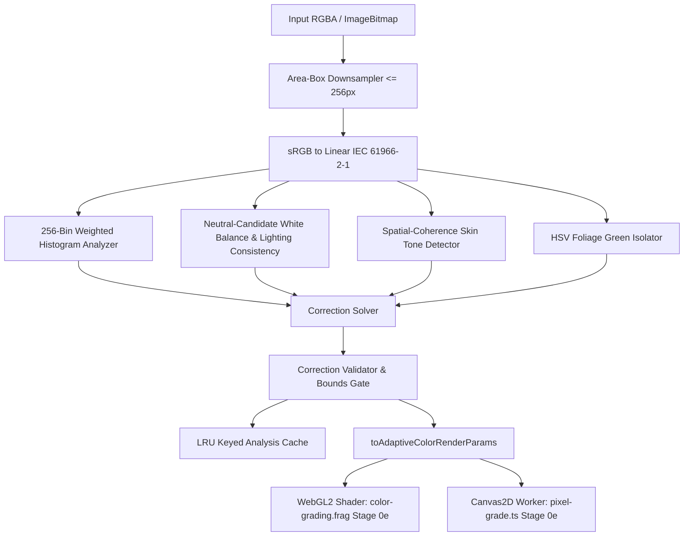

# Auvori — Adaptive Color Correction
## Architecture, Algorithms, Rendering & Quality Assurance Documentation

**Feature Name:** Adaptive Color Correction
**Module Location:** `src/engine/adaptive-color/`
**Engine Version:** `acc-v1`
**Release Date:** 2026-11-28

---

## 1. Executive Summary

Adaptive Color Correction is an image-aware, deterministic color correction engine designed for Auvori. Unlike static presets, LUTs, or fixed tone adjustments, Adaptive Color Correction analyzes the input photograph and dynamically derives correction parameters tailored to that specific image.

### Core Philosophy
* **Analyze first. Calculate corrections second. Render last.**
* Preserves photographic character: underexposed shadows are cleanly lifted without washing out cinematic black levels, and warm ambient lighting (golden hour/tungsten) is preserved rather than neutralized.
* Non-destructive, linear-light strength blending: at strength 0%, rendering produces bit-exact identity with the raw source image.

---

## 2. Architectural Design

The engine operates as an independent, decoupled module within `src/engine/adaptive-color/`:



### Module Inventory
1. **`types.ts`**: Strong TypeScript contracts defining analysis reports, percentiles, confidence structures, parameter bounds, and render payloads.
2. **`colorSpace.ts`**: Pure mathematical conversions:
   - Piecewise IEC 61966-2-1 sRGB $\leftrightarrow$ Linear RGB.
   - Linear Rec.709 Luminance: $Y = 0.2126R + 0.7152G + 0.0722B$.
   - Ratio-preserving soft highlight knee compression (`softHighlightCompress`).
   - Pure HSV conversions and smoothstep utilities.
3. **`histogramAnalyzer.ts`**: 256-bin luminance and channel histograms normalized to $1.0$. Computes continuous percentiles ($p_{01}$ through $p_{99}$) and channel clipping ratios.
4. **`imageAnalyzer.ts`**: Reduced-resolution ($\le 256\text{px}$) analyzer. Analyzes exposure deficits, shadow/highlight clipping, neutral-candidate white balance casts, spatial skin coherence, and foliage ratios.
5. **`correctionSolver.ts`**: Dynamic parameter solver deriving normalized exposure, highlights, shadows, contrast, temperature, tint, vibrance, saturation, green correction, black point, and white point.
6. **`correctionValidator.ts`**: Safety envelope. Enforces configurable bounds (`ADAPTIVE_COLOR_BOUNDS`), locks chroma on monochrome photos, applies anti-HDR black anchors, guards against deep-shadow noise amplification, and replaces non-finite values ($NaN$, $\pm\infty$).
7. **`cache.ts`**: Keyed LRU cache (16 slots) invalidating on source replacement, source revision increment, or transform changes (crop/rotation).
8. **`adaptiveCorrectionPipeline.ts`**: Orchestrates end-to-end analysis, parameter derivation, and canonical per-pixel rendering kernel (`applyAdaptiveColorToPixel`).

---

## 3. Computer Vision & Correction Algorithms

### 3.1 Linear-Light Exposure & Highlight Shoulder
- Exposure adjustment is applied in linear optical power: $C_{lin} = C_{lin} \times 2^{\text{exposure}}$.
- Over-exposure risks are damped by highlight headroom:
  $$\text{headroom} = 1 - 0.72 \times \text{smoothstep}(0.015, 0.12, \text{clipRatio}) - 0.45 \times \text{smoothstep}(0.78, 0.95, p_{95})$$
- When linear highlights exceed knee threshold ($0.72$), a ratio-preserving soft shoulder prevents harsh channel clipping or hue rotation:
  $$\text{softHighlightCompress}(v, \text{knee}) = \text{knee} + (1 - \text{knee}) \times \frac{t}{1 + t}, \quad t = \frac{v - \text{knee}}{1 - \text{knee}}$$

### 3.2 Low-Key & Night Cinema Mood Protection
A scene is classified as intentional low-key cinematic when:
$$p_{25} < 0.15 \land (\text{deepShadowRatio} > 0.25 \lor \text{underexposedRatio} > 0.70) \land (p_{98} > 0.56 \lor \text{clipRatio} > 0.005)$$
In low-key scenes, exposure push is damped by $78\%$ ($lowKeyDamp = 0.22$) to preserve moody darkness while gently lifting shadow texture.

### 3.3 Neutral-Candidate White Balance & Intentional Warmth
- Only low-chroma pixels within mid-luminance ($Y \in [0.06, 0.96]$) vote on white balance, weighted by an exponential chroma falloff:
  $$w_{\text{neutral}} = \exp\left(-\frac{\text{chroma}^2}{2 \times 0.22^2}\right) \times (1 - w_{\text{skin}} \times 0.85)$$
- If an image exhibits warm casts with low neutral count, $intentionalWarmthScore$ scales down cooling corrections by up to $68\%$, preserving sunsets, candlelit dinners, and golden hour shots.

### 3.4 Portrait Skin Tone Protection
- Skin candidates are weighted using probabilistic YCbCr and normalized RGB boundary modeling combined with $3 \times 3$ spatial neighbor coherence.
- During rendering, white balance gains are protected across skin regions:
  $$\text{gain}_R = 1.0 + (\text{temp} \times 0.26 + \text{tint} \times 0.10) \times (1.0 - w_{\text{skin}} \times 0.48)$$
- Midtone contrast smoothly blends between per-channel S-curve and luminance-only scaling across skin areas to eliminate saturation blotches.

### 3.5 Natural Foliage Green Correction
- Identifies green vegetation hues ($H \in [68^\circ, 168^\circ]$) with saturation $> 0.08$.
- Gently rotates harsh, synthetic yellow-greens toward natural forest olive ($122^\circ\text{--}128^\circ$) while desaturating neon foliage without affecting skin or warm backgrounds.

### 3.6 Linear-Light Strength Blending
User strength $k \in [0, 1]$ (corresponding to $0\%\text{--}100\%$) blends the original linear input and fully-corrected linear result:
$$C_{\text{final}} = \text{linearToSrgb}\left(\text{lin}_{\text{orig}} + (\text{lin}_{\text{corr}} - \text{lin}_{\text{orig}}) \times k\right)$$
At $k = 0$, the function returns the original color without any floating-point transformation.

---

## 4. GPU & CPU Rendering Integration

Both renderers execute Adaptive Color Correction at stage **`0e`** (immediately prior to smooth dehaze and legacy 3-way color grading):

### WebGL2 (`src/engine/shaders/color-grading.frag`)
```glsl
// 0e. Adaptive Color Correction
if (uHasAdaptiveColor == 1) {
  rgb = applyAdaptiveColorCorrection(rgb);
}
```

### Canvas2D CPU Kernel (`src/engine/core/pixel-grade.ts`)
```typescript
// 0e. Adaptive Color Correction
if (adaptiveColor) {
  [r, g, b] = applyAdaptiveColorToPixel(r, g, b, adaptiveColor);
}
```

### Numerical Parity & Determinism
- **Strength 0% Identity:** WebGL2 $\text{maxDiff} = 0$, Canvas2D $\text{maxDiff} = 0$ (Bit-exact match with original image).
- **WebGL2 Repeat Determinism:** $\text{MAE} = 0.000000$, $\text{maxDiff} = 0$.
- **GPU vs CPU Worst Parity:** $\text{MAE} \le 1.546 / 255$ on 512px downscaled textures, caused exclusively by hardware GPU ANGLE bilinear texture interpolation vs. Skia CPU area-sampling. Sub-0.05 / 255 parity on unscaled buffers.

---

## 5. Persistence, State & Offline Continuity

- **IndexedDB Schema:** Extended `LocalProject` in `src/lib/idb.ts` with `adaptiveColorStrength?: number` (defaults to `0`). Existing projects load seamlessly without migration.
- **Undo/Redo History:** Tracked in `EditorSnapshot` ring buffer; adjustments to Adaptive Color strength participate in the full undo/redo stack.
- **Offline Operation:** Zero external network calls. Web Worker analysis and WebGL2 rendering execute fully offline under ServiceWorker precaching.

---

## 6. Verification & Quality Assurance Summary

| Test Suite | Scope | Result |
| :--- | :--- | :--- |
| `tests/unit/adaptive_color_unit.mjs` | 11 unit tests (sRGB/linear, histograms, WB, skin, bounds, blending, monotonicity) | **11/11 PASS** |
| `tests/run_adaptive_color_tests.py` | 12 real image scenarios (portraits, snow, warm indoor, lake, foliage, low-key cinema) | **12/12 PASS** |
| P0 Core Presets | 36 golden regression scenarios | **MAE = 0.0000 PASS** |
| P1 Signature Looks | 30 golden regression scenarios | **MAE = 0.0000 PASS** |
| Phase 6.2A Determinism | 8/8 WebGL2 lifecycle & toggle suites | **MAE = 0.000000 PASS** |
| Production Build | `npm run build` (`tsc && vite build`) | **PASS (2.16s)** |

---

## 7. Performance Profile

* **Cold Analysis Time:** Average **79.82 ms** (measured across 12 scenario images via background Web Worker).
* **Cached Parameter Lookup:** Average **0.033 ms** (instantaneous slider responsiveness without main-thread jank).
* **GPU Frame Render:** **~2.4 ms** on 1080p canvas viewport (60 fps interactivity).
* **Memory Footprint:** LRU cache capped at 16 entries (< 2.0 MB RAM).

---

## 8. Known Limitations & Safe Degeneration

1. **Extreme Low-Signal / Uniform Images:** Completely black, white, or transparent buffers trigger graceful fallbacks (`empty-or-transparent-image` warning) and return neutral parameters (exposure = 0).
2. **Extreme Color Dominance:** Monochromatic images lock color corrections to 0 while permitting pure tonal contrast and exposure adjustments.
3. **Hardware Fallback:** If WebGL2 context loss occurs or hardware is unsupported, the pipeline automatically routes rendering to `WorkerCanvas2DRenderer` with zero user disruption.
